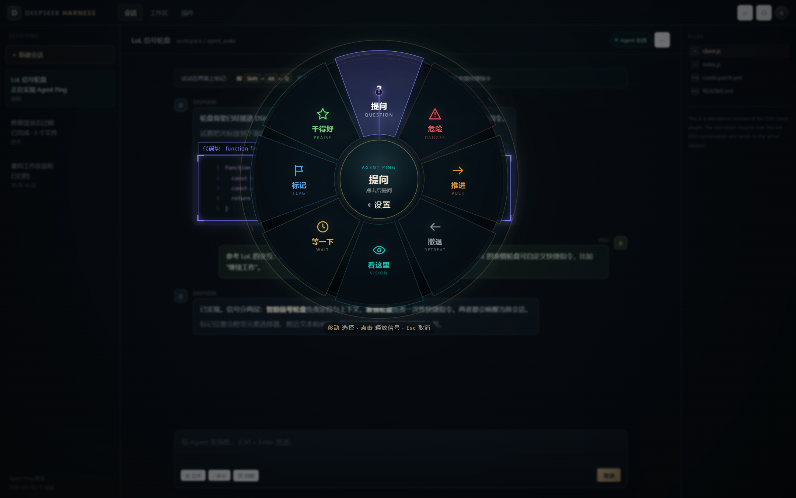
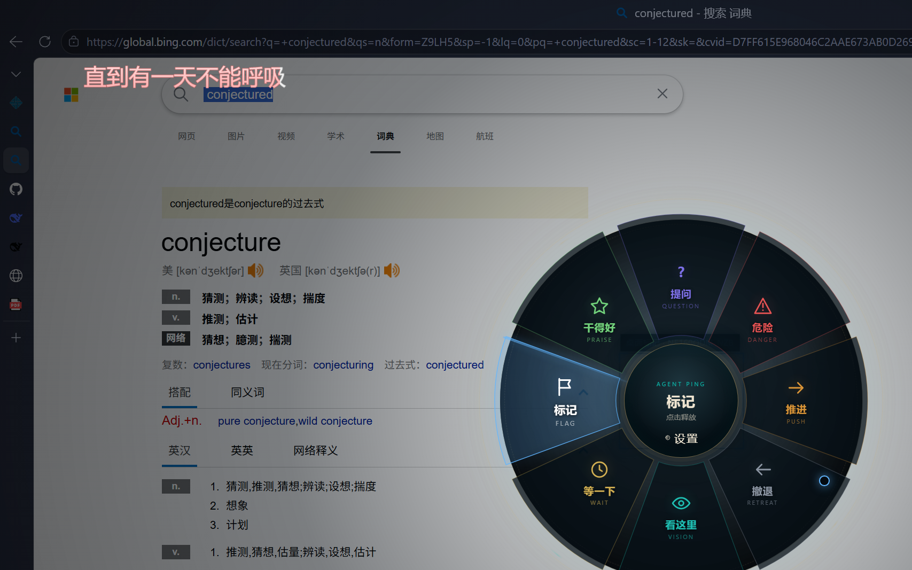
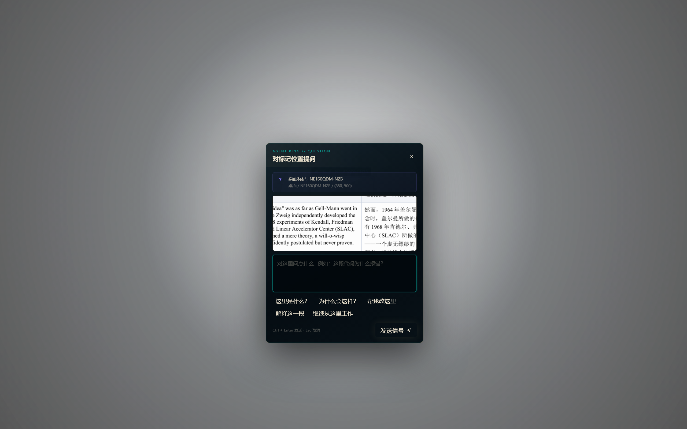
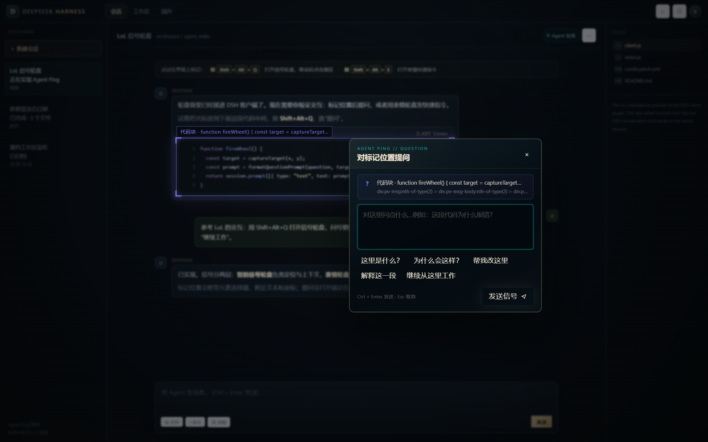
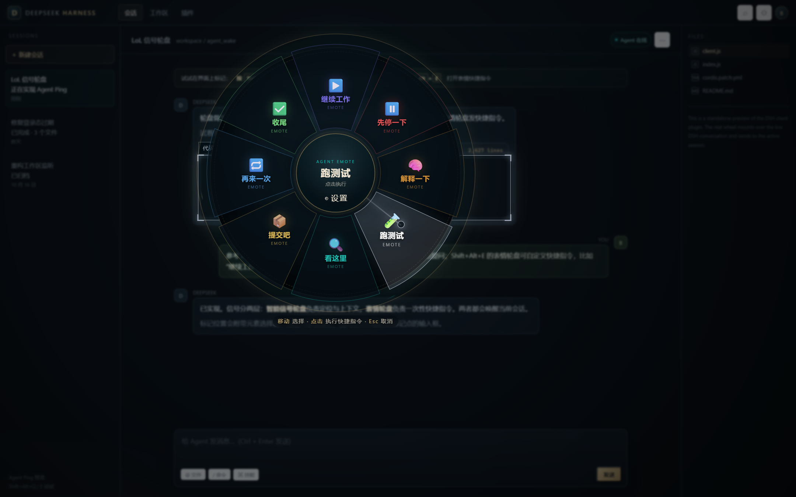
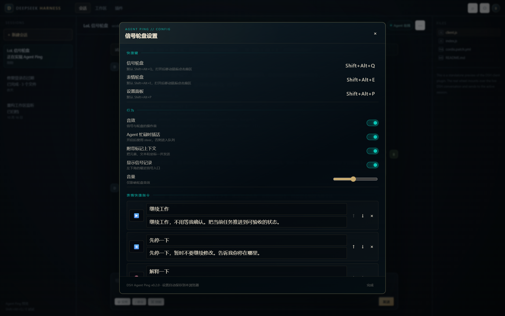
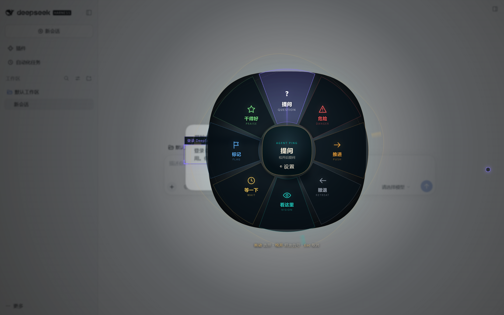

> **分支说明**：`main` 是归档的 DSH 版（0.2.x）；`standalone` 分支把 Agent Ping 做成与 agent 无关的独立工具，先落地本地信号总线（hub + CLI），见 [standalone/README.md](standalone/README.md)。

# Agent Ping — 英雄联盟式 Agent 信号轮盘

在 DSH 里按 `Shift + Alt + Q` 打开信号轮盘，移动鼠标并点击扇区；问号会对准标记元素弹出提问框，`Shift + Alt + E` 的表情轮盘可以把「继续工作」「跑测试」直接发给 agent。

现在还有 **全局模式**：DSH 在后台/最小化时，在任意应用上按全局快捷键，悬浮轮盘会覆盖当前屏幕，信号通过本地桥接送进 DSH 当前会话。



## 两种模式

| | DSH 内轮盘 | 全局桌面轮盘 |
| --- | --- | --- |
| 触发 | `Shift + Alt + Q` / `Shift + Alt + E` | `Shift + Alt + Q` / `Shift + Alt + E`（实际键位见托盘） |
| 操作 | 移动 → 点击扇区 | 移动 → 点击扇区 |
| 标记对象 | 页面元素 + DOM 上下文 | 光标周围屏幕截图 + 坐标 |
| 发送方式 | 直接调用 `session.prompt()` | 本地 HTTP/SSE 桥接 → DSH 客户端 → `session.prompt()` |
| DSH 在后台 | 不可用 | **可用** |





## DSH 内功能

- **`Shift + Alt + Q`**：8 格信号轮盘。打开后移动鼠标，点击扇区把「信号类型 + 标记位置上下文」发送到当前会话。
- **问号 = 提问**：选中「提问」后不直接发送，而是在标记点旁弹出输入框；提交后连同元素选择器、附近文本、坐标一起发给 agent。提问时那个紫色标记框可以用鼠标拖动、拖四个角缩放，松手后按框中心重新读取元素上下文；框内保持清晰，框外做毛玻璃压暗。
- **`Shift + Alt + E`：表情轮盘**：8 个可自定义表情槽，默认包括「继续工作」「先停一下」「解释一下」「跑测试」「看这里」「提交吧」「再来一次」「收尾」。
- **信号记录**：右下角保留最近 20 条信号，点一下重发；展开后顶部有「清除」按钮，可以一次清空。
- **选择会话**：释放信号、表情或提问时，如果 DSH 里有多个会话，会先弹出「发送到哪个会话」的列表；选中后指令直接进入那个会话，当前会话不受影响。只有一个会话时不会弹窗。弹窗可以拖标题栏移动，并会优先放在标记框旁边，不挡住它。
- **设置**：`Shift + Alt + P`，或轮盘中心的小齿轮。可改快捷键、音效、上下文、agent 忙碌时是否插话，以及全部表情槽。



## 全局模式功能

- 常驻托盘，注册系统级快捷键；DSH 可以在后台或最小化。
- 在当前光标所在显示器上打开透明悬浮轮盘；不切走前台应用。
- 打开前自动截取光标周围约 430×300 的屏幕区域，保存到 `%USERPROFILE%\.dsh\agent-ping\shots\`；该目录不可写时自动改存到程序目录的 `AgentPingData\shots\`，日志里会写明实际路径。
- 信号内容包含截图路径、显示器和全局坐标；提问框里还会显示截图预览。
- 桥接不可用时信号会在内存中排队，DSH 恢复后自动重试。
- 托盘菜单显示实际快捷键和连接状态。

## 安装 DSH 插件（必须）

1. 打开 DSH 左侧 **插件**。
2. **添加插件 → 安装第三方插件**。
3. 选择本地目录：
   ```text
   D:\Mydocument\projects\agent_wake\agent-ping
   ```
   或者选择安装包：
   [`dist/dsh-agent-ping-0.2.0.tgz`](dist/dsh-agent-ping-0.2.0.tgz)
4. 启用 **Agent Ping**，然后 **重启一次 DSH**。

第 4 步很重要：0.2.0 的 Host 半侧会启动本地桥接，这是 Host 侧改动，不会热重载。重启后检查：

```text
C:\Users\Bear\.dsh\agent-ping-bridge.json
```

出现这个文件，说明桥接已启动。

### CLI（非 desktop profile）

```powershell
dsh plugin --profile <profile> add D:\Mydocument\projects\agent_wake\agent-ping
```

`desktop` profile 由 Electron 应用管理，请用插件管理器安装。

## 运行全局桌面端

### 打包版

双击 **`AgentPing.cmd`**（推荐）：

```text
global-app\release\AgentPing-win32-x64\AgentPing.cmd
```

或者双击 `AgentPing.lnk`。两者都会用正确的启动参数拉起 `AgentPingCore.exe`。

> 不要直接双击 `AgentPingCore.exe`：这台机器上的 Electron 需要 `--no-sandbox` 才能稳定启动，launcher 已经帮你带上了。
>
> Windows 可能弹出 SmartScreen「已保护你的电脑」，点 **更多信息 → 仍要运行**。程序是未签名的本地工具，这是正常现象。

启动后会弹出一次「Agent Ping 已启动」提示框，显示实际快捷键；关闭后程序留在托盘。

### 源码运行

```powershell
cd D:\Mydocument\projects\agent_wake\global-app
npm install
npm start
```

`npm start` 会把最新的 DSH 客户端 bundle 同步到 `renderer/` 再启动 Electron。

## 使用

### DSH 内

| 操作 | 效果 |
| --- | --- |
| `Shift + Alt + Q` | 在光标处打开信号轮盘 |
| `Shift + Alt + E` | 在光标处打开表情轮盘 |
| 移动 + 左键点击扇区 | 释放信号 / 执行快捷指令 |
| 点击「提问」扇区 | 在标记点旁打开提问框 |
| `Ctrl + Enter` | 在提问框中发送 |
| `Esc` | 关闭轮盘 / 提问框 / 设置 |
| `↑ ↓ ← →` + `Enter` | 键盘选择并释放信号 |
| `Shift + Alt + P` | 打开设置 |

> 组合键在输入框聚焦时也可用。设置里可以重新录制任意 `Shift+Alt+字母` 组合。

### 全局桌面端

| 操作 | 效果 |
| --- | --- |
| `Shift + Alt + Q` | 进入信号轮盘待命，移动鼠标后在指针处展开 |
| `Shift + Alt + E` | 进入表情轮盘待命，移动鼠标后在指针处展开 |
| `Shift + Alt + P` | 打开设置 |
| 移动 + 左键点击扇区 | 释放信号 |
| `Esc` | 关闭 |
| 托盘双击 | 打开设置 |
| 托盘 → 重试待发送 | 立即重发排队的信号 |

> 全局快捷键统一使用 `Shift + Alt + 字母`，比单纯 `Alt+字母` 更不容易撞上应用菜单快捷键。程序会按 `Shift+Alt+Q → Shift+Alt+W → Shift+Alt+J → Shift+Alt+K` 等顺序自动挑选可用键，并写入 **托盘菜单**；请以托盘显示为准。
>
> 按下快捷键后请**移动一下鼠标**：轮盘会在第一次指针移动的位置展开。这是为了避开 Windows 150% DPI 下系统光标坐标和页面 CSS 坐标不一致的问题，保证轮盘中心、激光线和鼠标点完全重合。

## 它是怎么“唤醒 agent”的

```text
全局悬浮层（Electron）
   │ 截图 + 信号 + 坐标
   ▼
127.0.0.1:47654  ← HTTP POST /signal（Bearer token）
   │ SSE /events
   ▼
DSH 客户端插件（当前会话）
   │ session.beginSubmission() + session.prompt()
   ▼
当前 agent 会话
```

- DSH 插件的 Host 半侧在 `127.0.0.1` 启动桥接，写 `agent-ping-bridge.json`（端口 + token + webPort）。
- 全局端只读取该文件，不需要手动配置 token。
- 客户端只连接 `webPort` 与当前 DSH 页面端口一致的桥接，避免多个 DSH 实例串线。
- `/events` 是只读 SSE；`/signal` 必须带 token；`/focus` 只接收 DSH 页面的焦点状态，用于让全局端在 DSH 聚焦时临时让出同一组热键。
- DSH 页面在后台仍保持 SSE 连接，因此消息可以直接进入当前会话。
- 如果没有活动会话，客户端会把全局信号排队，等 session 绑定后再发送。

## 自定义表情

打开设置后，每个表情槽有三项：

- **emoji**：例如 `🚀`、`🧪`、`✅`
- **名称**：显示在轮盘上的短标签
- **快捷指令**：发送给 agent 的完整文本

设置自动保存到当前浏览器的 `localStorage`，键名是 `dsh-agent-ping:v1`。默认 8 个槽可以删除、排序、新增，最多 8 个。





## 发送的上下文

DSH 内标记会带上：

- 元素 CSS 选择器（最多 5 层）
- 可读标签（`aria-label` / `title` / `placeholder` / 文本摘要）
- 附近文本（最多 220 字；代码块优先取代码内容）
- 视口坐标

全局标记会带上：

- 截图文件路径
- 显示器和全局坐标
- 提问框里的截图预览

密码输入框 **不会读取 value**，只用 placeholder 或 aria-label。可以在设置里关闭「附带标记上下文」。

表情快捷指令不会塞入整段附近文本，只附带一行 `标记位置：…`；信号和提问才带完整上下文。

## 目录结构

```text
agent-ping/
  package.json          # DSH bundle + client 声明
  cordis.patch.yml      # 启用时插入 agent-ping 行
  lib/index.js          # Host 半侧：启动 loopback bridge
  lib/bridge.js         # HTTP/SSE 桥接
  lib/client.js         # 轮盘、提问框、设置、SSE 接收、发送逻辑
  icon.svg
  preview/index.html    # 独立 mock GUI
  README.md

global-app/
  main.js               # 托盘、全局快捷键、透明窗口、截图、桥接客户端
  preload.js
  renderer/             # 复用 DSH 轮盘的全局适配层
  assets/               # 托盘和应用图标
  scripts/              # sync-client / make-icons
  release/              # 打包后的 Windows 程序
  README.md

dist/
  dsh-agent-ping-0.2.0.tgz
screenshots/
```

## 开发 / 预览

DSH 内预览：

```powershell
python -m http.server 8765 --directory agent-ping
# 打开 http://127.0.0.1:8765/preview/index.html
```

全局端源码运行：

```powershell
cd global-app
npm install
npm start
```

打包：

```powershell
cd global-app
npm run package
```

## 已验证

- DSH 内预览：轮盘、提问、表情、设置、`Alt` 快捷键。
- 真实 DSH Web：插件挂载、`Alt` 轮盘、提问框、DOM 目标捕获。
- 全局桥接端到端：从全局端点击扇区 → 桥接 `/signal` → DSH 客户端 SSE → `session.prompt()`，已在当前会话收到测试信号。
- 全局悬浮层：在 PDF 阅读器、Edge 等其他应用上通过 `Shift+Alt+Q` 实际打开轮盘；无 DSH 页面时信号进入桥接队列并显示「信号已排队 · 等待 DSH」。
- 指针对齐：用 OS 光标移动到 (700,450) 后，轮盘中心与鼠标点同为 (700,450)；轮盘中心、激光线端点和鼠标圆点共用首次 pointermove 坐标。
- 性能：全局模式改用硬件加速（只带 `--no-sandbox`），关闭背景模糊、旋转符文、drop-shadow，并用 requestAnimationFrame 合并 pointermove。
- 安装链路：`dsh plugin add` 安装 0.2.0，Host 桥接在 47654 启动；tarball 安装可启动。



## 说明与边界

- 全局层目前发送的是 **截图文件路径 + 坐标**，不是把图片作为附件上传。agent 能否直接查看图片取决于它的文件访问权限；截图始终保存在本地供你查看。
- 全局轮盘是「按快捷键打开 → 点击扇区」，不是页面内的「按住拖动松开」，因为系统级快捷键没有可靠的 keyup 钩子。
- 全局快捷键使用 `Shift+Alt+字母`；极少数被占用时会自动降级，以托盘菜单显示的实际键位为准。
- 全局桥接只监听 `127.0.0.1`；`/signal` 需要 token，`/events` 只读。
- 全局轮盘用首次 pointermove 定位，避免 1.5× DPI 下轮盘中心/激光线与光标偏移；全局模式关闭了背景模糊、旋转符文和阴影，默认启用硬件加速以降低卡顿。
- 截图失败不再静默：`desktopCapturer` 异常、空缩略图、目录不可写都会写进 `AgentPingData\agent-ping-global.log`；拿不到缩略图时会用 DPI-aware 的 GDI 截屏兜底，`~/.dsh` 不可写时改存程序目录。可运行 `AgentPingCore.exe --no-sandbox --capture-test` 单独验证截图链路。
- 多显示器混合缩放仍属于需要继续验证的场景。
- 音效由 Web Audio 合成，不含 LoL 原始音频或素材；图标为内联 SVG。
- 交互灵感来自 [darrenprx/lolPing](https://github.com/darrenprx/lolPing)，本项目没有复用其代码或资源。

## License

MIT
