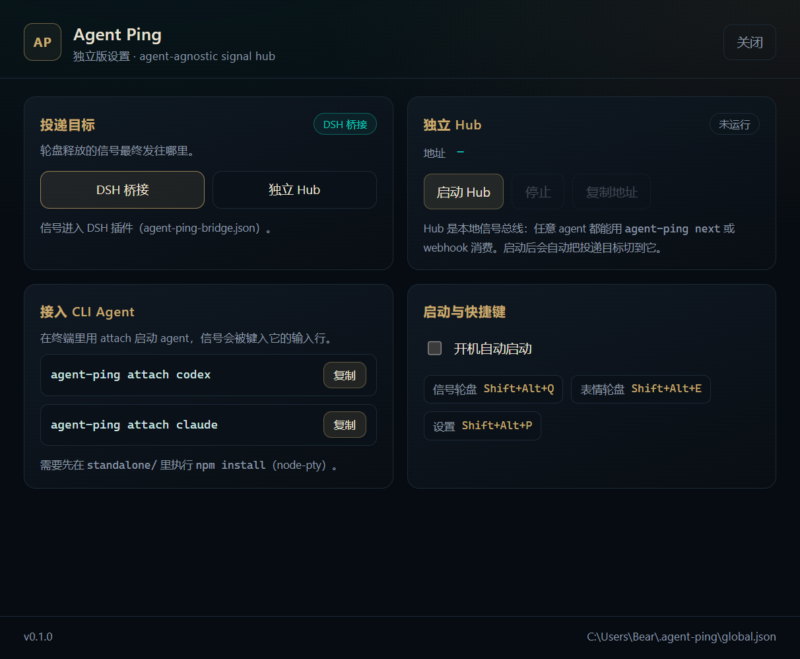

# Agent Ping — standalone

Agent Ping started as a DSH plugin: a League-of-Legends-style wheel that sends a
signal plus the thing you marked to the current DSH conversation. This branch
turns it into a **tool that any agent can consume**, with DSH as just one
consumer.

The idea is the same in every case: you mark something on screen, pick a signal,
and the agent that owns that screen should get the prompt — whether it is DSH, a
CLI agent, an IDE assistant, or a custom script.

## Architecture

```text
  wheel / overlay / script
          │  POST /signal  (token)
          ▼
   agent-ping hub  127.0.0.1:47660
     ├── GET /next       competing consumers: an agent claims one signal
     ├── POST /subscribe webhook push: an agent registers a URL
     └── GET /events     read-only SSE: monitors, dashboards, the overlay
```

The hub is deliberately small and dependency-free (Node built-ins only):

- loopback only, bearer-token protected for `/next`, `/signal` and `/subscribe`;
- signals are delivered to **one** consumer: a waiting `/next`, then a webhook,
  otherwise queued (max 50);
- a consumer can be a shell loop, a Node/Python script, an editor extension, a
  DSH bridge adapter, or the wheel itself.

## Quick start

```powershell
# 1) start the hub (leave it running; it writes ~/.agent-ping/hub.json)
node standalone/cli.js hub

# 2) another terminal: send a signal
node standalone/cli.js send "看一下这段报错" --label "看这里"

# 3) an agent claims it
node standalone/cli.js next --timeout 30
```

`next` prints the prompt and exits 0; it exits 2 when the timeout expires, so a
loop can distinguish "no work" from failure.

```bash
# a minimal agent loop
while true; do
  prompt="$(agent-ping next --timeout 60)" || continue
  my-agent --prompt "$prompt"
done
```

## HTTP protocol

| Method | Path | Auth | Purpose |
| --- | --- | --- | --- |
| `GET` | `/health` | no | status, queue and consumer counts |
| `GET` | `/events` | no | SSE feed of every signal (read-only) |
| `GET` | `/next?timeout=25` | yes | claim one signal; `204` on timeout |
| `POST` | `/signal` | yes | publish `{ prompt, label, emoji, source, target }` |
| `POST` | `/subscribe` | yes | register a webhook URL |

Auth is `Authorization: Bearer <token>` or `X-Agent-Ping-Token: <token>`; the
token lives in `~/.agent-ping/hub.json` (override the directory with
`AGENT_PING_HOME`).

`POST /signal` returns which path took the signal: `claimed`, `webhook` or
`queued`.

## Wiring the wheel to the hub

The tray menu has **投递目标 → DSH 桥接 / 独立 Hub**; switching writes (or removes)
`~/.agent-ping/global.json`:

```json
{ "endpoint": "http://127.0.0.1:47660" }
```

The global overlay then posts every signal to that endpoint instead of the DSH
bridge. When the endpoint matches the running hub (`~/.agent-ping/hub.json`),
its token is picked up automatically; a remote endpoint needs an explicit
`"token"` in the same file. If the home directory is not writable, the override
falls back to `AgentPingData\global.json` next to the executable.

For scripts, the same switch without the tray:

```powershell
AgentPingCore.exe --no-sandbox --target=hub
AgentPingCore.exe --no-sandbox --target=dsh
```

Because the hub is agent-agnostic, the inline screenshot data URL is dropped for
hub sends (the `target.text` still carries the saved screenshot path); a test
signal is under 1 KB instead of ~150 KB.

To verify the whole path without opening the wheel:

```powershell
AgentPingCore.exe --no-sandbox --send-test
# then, in another terminal:
agent-ping next --timeout 5
```

The app log records the resolved transport (`"transport":"hub"`) and the hub
receipt.

## Desktop app: tray + settings

The packaged tray app is also the standalone control panel. It lives in the
background with a tray icon and opens a proper **应用设置** window (double-click
the tray icon, or tray → 应用设置…):



- **投递目标**: DSH bridge or the standalone hub.
- **独立 Hub**: start/stop the hub **inside the tray app** (no extra terminal),
  copy its address, see whether it is embedded or external.
- **接入 CLI Agent**: copy-ready `agent-ping attach codex` / `claude` commands.
- **启动与快捷键**: autostart with Windows, and the hotkeys that actually
  registered.

Starting the hub from the settings page also switches delivery to it. An
externally started hub is reused instead of starting a second one.

Scriptable flags:

```powershell
AgentPingCore.exe --no-sandbox --settings        # open the settings window
AgentPingCore.exe --no-sandbox --start-hub       # tray app + embedded hub
AgentPingCore.exe --no-sandbox --settings-shot=<file>  # render the settings page to PNG
```

## CLI agents: Codex, Claude Code, anything interactive

`attach` runs a CLI agent inside a real PTY and types claimed signals into its
prompt line. Start it instead of the agent:

```powershell
# starts a hub if none is running, then launches Codex inside a PTY
agent-ping attach codex

# Claude Code, or any other interactive CLI
agent-ping attach claude
agent-ping attach -- my-agent --flag
```

Point the wheel at the hub (tray → **投递目标 → 独立 Hub**, or
`AgentPingCore.exe --target=hub`), then fire a signal. It is flattened to one
line and typed into the agent followed by Enter, exactly as if you had typed it.
Keystrokes and screen output are forwarded both ways, so the agent still works
as a normal terminal app; using the agent without Agent Ping is unaffected.

Notes:

- Multi-line prompts are flattened for typing (the agent sees one line); the
  target selector, text and coordinates are preserved in that line.
- Whether a signal sent while the agent is busy is queued or ignored is up to
  the agent (Claude Code queues typed input, for example).
- `attach` needs `node-pty`; run `npm install` in `standalone/` once. It uses
  Windows ConPTY, so no separate terminal emulator is required.
- For scripted agents, `agent-ping next` keeps working: claim a signal and pass
  it to whatever wants it.

Remaining adapters, in order:

1. ~~Global overlay → hub~~ (done: `global.json` endpoint, screenshot context
   unchanged).
2. ~~Interactive CLI agents~~ (done: `attach` with PTY injection).
3. **DSH adapter**: claims from the hub and routes to the chosen conversation.
4. **Webhook adapter**: documented payload, retries.

## Tests

```powershell
cd standalone
npm install        # node-pty, once
npm test           # hub tests + attach tests
```

The hub suite covers auth, queueing, long-poll claim, timeout, SSE fan-out,
webhook delivery and config lifecycle. The attach suite spawns a mock agent in a
PTY and checks signal injection, keystroke forwarding and exit-code
propagation.

## Relation to the DSH version

- `main` keeps the archived DSH plugin (`agent-ping/`, `global-app/`, 0.2.x).
- `standalone` is this rewrite; the DSH-specific code stays in the repo as one
  adapter, but the hub and CLI do not depend on DSH.

Version `0.1.0` — hub, CLI, wheel → hub delivery and the interactive CLI wrapper
(`attach`) work; the DSH adapter (claim from hub, route to a conversation) is the
next step.
